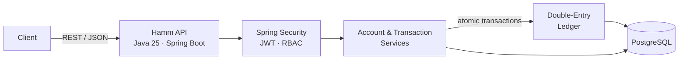
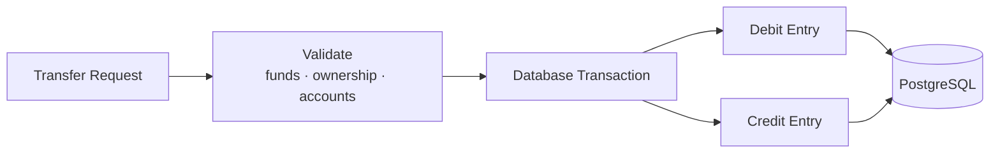

# Hamm

Secure Financial Ledger


## What's going on here

Hamm is the money-tracking part of a banking app. It keeps accounts, moves money between them, and writes down every move. It does this the way real accountants do, with double-entry bookkeeping. Every transfer is recorded twice, once as money leaving one account and once as money arriving in another.

Money code has to be careful. So Hamm is built to never lose track of a cent.

- A transfer either fully happens or doesn't happen at all
- Two people can't spend the same money at the same moment
- Every action needs a login, and your role decides what you can do
- Everything runs on test data, so there's no real money involved

## What it can do

- Register and log in, with stateless JWT login tokens
- Create and manage accounts
- Deposit, withdraw, and transfer money
- Record every move in a double-entry ledger
- Show an account's balance and its ledger history
- Restrict access by role: customers, accountants, auditors, and admins
- Return clear, consistent JSON errors
- Document itself with Swagger, so you can try the API in your browser

## How it fits together



## How a transfer works

Say you move $50 from account A to account B. Here's the whole story.

- Hamm checks that the amount is positive
- It checks that the two accounts are different
- It checks that both accounts are active
- It checks that the source account has enough money
- It checks that the transaction reference hasn't been used before
- It checks that you're allowed to use the source account
- Then it locks both accounts, always in the same order, so two transfers can't deadlock each other
- It writes a debit entry for A and a credit entry for B, and updates both balances
- If anything fails along the way, the whole thing rolls back, and no half-finished entries are left behind



Each ledger entry is meant to be written once and never changed. It records:

- Which transaction and account it belongs to
- Whether it's a debit or a credit
- The amount
- The balance afterward
- When it happened

## Security

Every endpoint needs a login token, except registering and logging in. Passwords are hashed with BCrypt.

- `CUSTOMER` can create accounts, deposit, withdraw, and transfer, but only on their own accounts
- `ACCOUNTANT` can do the same and also update accounts
- `ADMIN` can do all of that too
- `AUDITOR` can look at things
- Anyone who registers through the API becomes a `CUSTOMER`
- That's on purpose, so nobody can make themselves an admin by signing up
- There's no endpoint for granting the other roles yet, so for now you'd change a user's role in the database

## API

### Authentication

```text
POST /api/v1/auth/register
POST /api/v1/auth/login
```

### Accounts

```text
POST  /api/v1/accounts
GET   /api/v1/accounts
GET   /api/v1/accounts/{id}
PATCH /api/v1/accounts/{id}
GET   /api/v1/accounts/{id}/balance
GET   /api/v1/accounts/{id}/entries
```

### Transactions

```text
POST /api/v1/transactions/deposit
POST /api/v1/transactions/withdraw
POST /api/v1/transactions/transfer
GET  /api/v1/transactions
GET  /api/v1/transactions/{id}
```

Swagger UI has the full request and response details while the app is running.

## Why these technologies

Each tool was picked for a reason. Here's what each one does for Hamm.

- **Java and Spring Boot** are a well-tested pairing for APIs where mistakes are expensive
- **Spring Security and JWT** check who you are on every request, without the server keeping a session
- **BCrypt** scrambles passwords, so even the database never holds a real one
- **Spring Data JPA** lets the code work with the database without hand-writing SQL, and it handles the account locks
- **PostgreSQL** has strong guarantees for transactions, which matters when money is moving
- **H2** is a quick in-memory database, so most tests run without Docker
- **Testcontainers** runs a test against a real PostgreSQL, so it matches the real thing
- **Swagger and OpenAPI** build API docs from the code, and let you try requests in your browser
- **Docker Compose** starts the API and its database with one command
- **GitHub Actions** builds and tests every change automatically

## Getting started

You'll need Java 25, Docker, and Docker Compose. There are two ways to run it.

- Run the API and PostgreSQL together with `docker compose up --build`
- Or start only the database with `docker compose up db`, then run the API with `./mvnw spring-boot:run`

Once it's running, you can reach these.

| What | URL |
|---|---|
| API | http://localhost:8080/api/v1 |
| Swagger UI | http://localhost:8080/swagger-ui/index.html |
| Health check | http://localhost:8080/actuator/health |

## Try it

First, register a user.

```bash
curl -X POST http://localhost:8080/api/v1/auth/register \
  -H "Content-Type: application/json" \
  -d '{"email":"jane@example.com","password":"password123","fullName":"Jane Doe"}'
```

Copy the `accessToken` from the response. Then create an account with it.

```bash
curl -X POST http://localhost:8080/api/v1/accounts \
  -H "Content-Type: application/json" \
  -H "Authorization: Bearer <token>" \
  -d '{"currency":"USD"}'
```

## The data

There are four main things in the database.

- `User` is a person who can log in, and has one role
- `Account` belongs to a user and holds a balance
- `Transaction` is one deposit, withdrawal, or transfer
- `LedgerEntry` is one debit or credit line that belongs to a transaction and an account

```text
User
 └── Account
      └── LedgerEntry
            │
            └── Transaction
```

- Account numbers and transaction references are unique
- Amounts must be positive
- Ledger entries are indexed by account and time, so history loads quickly
- Tables are created automatically on startup
- There's no migration tool yet

## Errors and validation

- Requests are checked for things like required fields, positive amounts, and valid currency codes
- The service layer checks the business rules, like ownership, enough funds, active accounts, duplicate references, and self-transfers
- One global handler turns every failure into a consistent JSON response

## Testing

Run the tests with `./mvnw test`.

- Unit tests cover accounts, transactions, and JWT handling
- Integration tests cover registering, logging in, and the transaction flows through the API
- Those run against an in-memory H2 database, so they don't need Docker
- A separate Testcontainers test runs a workflow against a real PostgreSQL container
- That test skips itself when Docker isn't available, and runs in CI

## Configuration

Settings live in `src/main/resources/application.yml`. You can override them with environment variables.

- `DB_HOST`, `DB_PORT`, `DB_NAME`, `DB_USERNAME`, `DB_PASSWORD`
- `JWT_SECRET` and `JWT_EXPIRATION_MS`
- `SERVER_PORT`
- `docker-compose.yml` has the values Docker uses

> The default JWT secret is for local development only. Set a secure `JWT_SECRET` before running Hamm anywhere else.

## Project structure

```text
src/main/java/com/example/hamm/
├── account/        accounts and their API
├── auth/           register and login
├── transaction/    deposits, withdrawals, and transfers
├── ledger/         double-entry ledger entries
├── user/           users and roles
├── security/       JWT and Spring Security setup
├── exception/      custom errors and the global handler
├── config/         auditing and Swagger setup
└── common/         shared base classes
```

## Good to know

- Reversing a transaction isn't built yet
- A `REVERSED` status exists for it, but there's no endpoint that does it
- GitHub Actions builds the project, runs the tests, packages it, and builds the Docker image
- It doesn't publish the image anywhere
